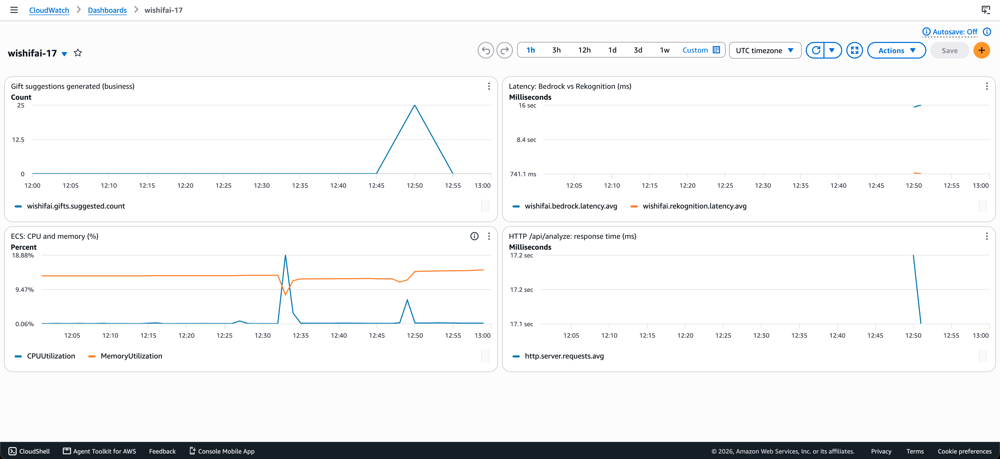

Kandidatnr: 17

## Oppgave 1A

### Kjøre containeren
```bash
docker build -t wishifai .
cp .env.example .env # AWS keys og bucket name her
docker run --rm -p 9999:8080 --env-file .env wishifai
```
Test: `curl -F "image=@samples/sample_image.png" http://localhost:9999/api/analyze`

### Valg
**Multi-stage build:** Første steg bruker jeg et Maven JDK 21-image til å bygge JAR-filen.
Andre steg starter jeg fra et clean JRE 21-image og kopierer kun inn den ferdige JAR-en.
Maven, JDK og kildekoden blir dermed ikke med i det siste imaget. Det gir et mindre image og raskere deploy.

**Caching av dependencies:** `pom.xml` kopieres og avheninghetene lastes ned før kildekoden kopieres inn.
Endringer i Java-koden gjør at ikke alle avheninghetene lastes ned pånytt og builden går kjappere.

**Ikke-root bruker:** Applikasjonen kjører som egen bruker (`spring`) i stedet for root.
Hvis en annen skulle klare å utnytte en sårbarhet i applikasjonen, får de da begrensede rettigheter i containeren.

**Hemmeligheter:** AWS-nøkler bygges ikke inn i imaget, men sendes inn som miljøvariabler ved oppstart via
`--env-file`. `.env` ligger i `.gitignore`, og `.env.example` viser hvilke variabler som må brukes.

## Oppgave 1B

**Workflow:** `.github/workflows/ci.yml`
**Grønn kjøring:** https://github.com/martinmyrvoll/pgr301-exam/actions/runs/42036946540

Workflowen kjører kun ved push til `main`. Den bygger Docker-imaget og pusher det til ECR repoet som jeg laget,
`wishifai-17`. AWS-nøklene ligger inne i Github under actions secrets. 

### Tagging-strategi
Hvert image får to tagger: den korte commit-SHA-en f. eks. `a1b2c3d` og `latest`.

**Commit-SHA:** Kobler hver image til nøyaktig én commit. Da kan man alltid se hvilken kode som kjører i ECS og finne
igjen commiten hvis noe skulle skjære seg. SHA-en er unik, så et gammelt image vil aldri bli overskrevet.
Rollback gjøres ved å deploye en eldre tag som virket.

**`latest`:** Bare for å gjøre det enkelt å hente nyeste versjon lokalt. Den brukes ikke til deploy, fordi den endrer
seg hele tiden og ikke sier noe om hvilken versjon det er.

Jeg valgte SHA fremfor klassisk verjsonering (f. eks. `1.0.2`), fordi det ikke krever noe manuelt arbeid.
Hver push til `main` får automatisk en unik og sporbar tag.

## Oppgave 2A

**URL:** https://wi-9565fee3b16a4b0dad130d667ca89d48.ecs.eu-west-1.on.aws

Test `curl -F "image=@samples/sample_image.png" <URL>/api/analyze`

Terraform-koden ligger under `infra/` og oppretter:
 - S3-bucket `wishifai-17-images` for bilder
 - Task role `wishifai-task-role-17` med tilgang til S3, Rekognition, Bedrock og CloudWatch
 - ECS Express-tjeneste som bruker de eksisterende execution of infrastructure rollene

`S3_BUCKET` settes automatisk fra bucket-resourcen, så appen og Terraform bruker alltid samme bucket.
Region, kandidatnr og image tag er variabler

## Oppgave 2B

State lagres i bucketet `pgr301-terraform-state` med nøkkelen `wishifai/17/terraform.tfstate`.
Kandidatnummeret i nøkkelen er unikt og gjør at ingen andre overskriver min state.
`use_lockfile` gjør slik at to kjøringer ikke kan endre state samtidig.

## Oppgave 2C

**Grønn kjøring:** https://github.com/martinmyrvoll/pgr301-exam/actions/runs/42616436243

Terraform-jobben har `needs: build`, så den kjører først når imaget er bygget og pushet til ECR.
Ellers kunne Terraform prøve å deploye en image-tag som ikke finnes enda og deployen ville feilet.
Hvis builden feiler, blir ingenting deployet. Image-taggen sendes fra build-jobben til Terraform,
så det som deployes er nøyaktig den koden som nettopp ble bygget.
Pipelinen feiler hvis koden ikke er formatert (`terraform fmt -check`).

## Oppgave 3A

Jeg la til Micrometer, og dataen blir sendt til CloudWatch under namespace `wishifai-17`.

| Metrikk | Type | Hvor |
|---|---|---|
| `wishifai.rekognition.latency` | Timer | `RekognitionService` |
| `wishifai.bedrock.latency` | Timer | `BedrockService` |
| `wishifai.gifts.suggested` | Counter | `WishlistService` |

**Timere for Rekognition og Bedrock:** Grunderen lurte på hva som tar så lang tid. Med en timer rundt hvert kall
kan jeg se hva som tar tid.

Resultat fra tester (snitt av 3):
- Rekognition: ca. 1,2 sekunder.
- Bedrock: ca. 14,2 sekunder.

Bedrock står altså for rundt 90% av responstiden. Prompten ber modellen tenke gjennom flere steg og skrive
en begrunnelse for hvert gaveforslag, noe som skaper mange output tokens og lang svartid. Hvis tjenesten
skal bli raskere, er det prompten og modellvalget som bør endres, ikke Rekognition eller S3.

**Business-metrikk - antall gaveforslag (`wishifai.gifts.suggested`):** Teller hvor mange gaveforslag tjenesten
har generert. Den sier noe om faktisk bruk av tjenesten, ikke bare om den er oppe. Hvis den flater ut, 
bruker ingen tjenesten, eller Bedrock returnerer tomme lister selv om alt ser bra ut.

## Oppgave 3B

**Grønn kjøring:**: https://github.com/martinmyrvoll/pgr301-exam/actions/runs/42816355908

**Dashboard:** `wishifai-17` (CloudWatch, eu-west-1). Koden ligger i `infra/monitoring.tf`.



Dataen i skjermbildet kommer fra 5 testkall mot ECS-tjenesten sendt med en curl-loop.

```bash
URL=https://wi-9565fee3b16a4b0dad130d667ca89d48.ecs.eu-west-1.on.aws
for i in 1 2 3 4 5; do curl -s -o /dev/null -w "%{http_code} %{time_total}s\n" \
-F "image=@samples/sample_image.png" $URL/api/analyze; done
```

### Metrikker i dashboardet
| Widget | Type | Hvorfor |
|---|---|---|
| Antall gaveforslag | Business | Viser faktisk bruk av tjenesten |
| Bedrock vs Rekognition latency | Egne metrikker | Viser hvor tiden blir av i hvert kall |
| ECS CPU og minne | Infrastruktur | Viser om containeren har nok ressurser eller må skaleres |
| HTTP-responstid for `/api/analyze` | Applikasjon (Actuator) | Total tid brukeren venter, inkludert S3 og egen kode |

Ved å se Bedrock-latency og HTTP-responstid ved siden av hverandre ser man at nesten hele responstiden kommer fra
Bedrock. CPU og minne er lave, så tregheten skyldes ikke for lite ressurser i containeren.


### Alarm
`wishifai-17-bedrock-latency-high` går av hvis gjennomsnittlig svartid fra Bedrock er over
25 sekunder i to perioder på 5 minutter på rad.

- **Hvorfor Bedrock:** Det er den tregeste delen av tjenesten, og den vi har minst kontroll over (modellen svartid
    og last hos AWS).
- **Tersekl 25 sek:** Godt over normalen på ca. 14 sekunder, så vanlig variasjon ikke utløser alarmen,
    men en ekte forverring blir fanget opp.
- **2 x 5 minutter:** Én treg forespørsel gir ikke alarm, bare varende treghet.
- **`treat_missing_data = notBreaching`:** Ingen trafikk betyr ingen data, og det er ikke en feil.

